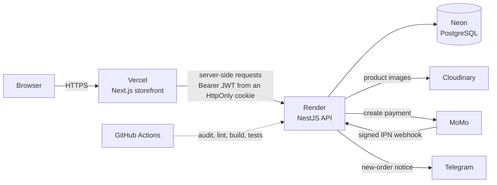
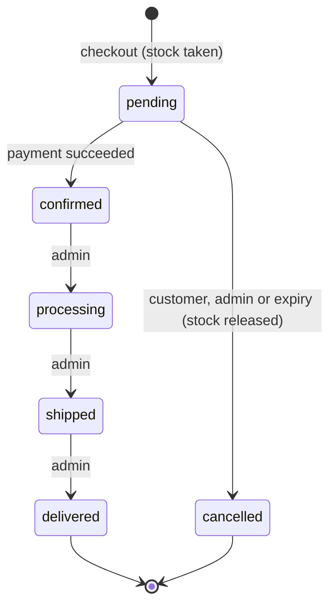
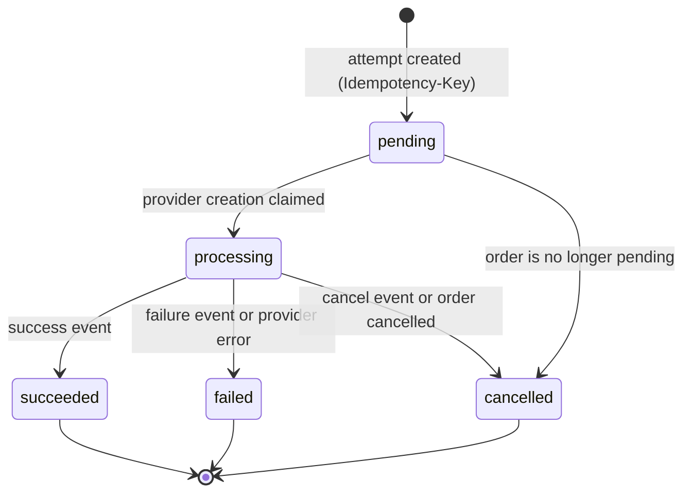
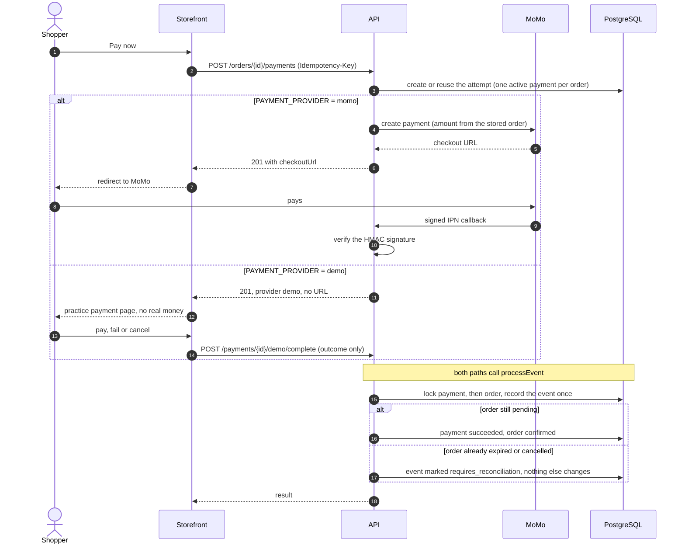
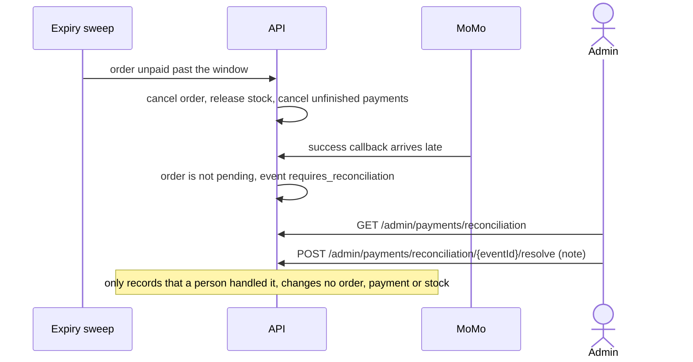

# Evergreen Store backend

The REST API of a small fashion store: catalog, cart, checkout, payments and
order management, built with NestJS, TypeORM and PostgreSQL. It is the backend of
a portfolio project; the storefront that uses it lives in a separate repository.

The parts worth reading: **payments that stay correct when callbacks are late,
repeated or concurrent**, **stock that cannot be oversold**, **rate limits that
work behind a shared proxy**, and **tests that run against a real database**.

## Try it

| What | Where |
| --- | --- |
| Storefront (Next.js on Vercel) | <https://ecommerce-frontend-kappa-sage.vercel.app> |
| About this demo (what is real, what is simulated) | <https://ecommerce-frontend-kappa-sage.vercel.app/about-demo> |
| This API (NestJS on Render), health check | <https://ecommerce-backend-i5fc.onrender.com/health> |
| Storefront repository | <https://github.com/misu2tdt/ecommerce-frontend> |
| API repository | <https://github.com/misu2tdt/ecommerce-backend> |

The health endpoint is what Render probes: it returns `{"status":"ok"}` after a
`SELECT 1` against the database. The API runs on a free instance that sleeps when
idle, so the first request after a pause is slow.

The demo store never takes real money. When `PAYMENT_PROVIDER=demo` a visitor
finishes an order on a clearly labelled practice payment page; see
[docs/payments.md](./docs/payments.md).

## Architecture



The browser never calls the API directly: the Next.js server does, with the
session JWT kept in an HttpOnly cookie on the storefront's own origin. The API
therefore sees one shared client address, which shapes the
[rate limiting](#rate-limiting).

The API is one NestJS application with a module per area:

| Module | Responsibility |
| --- | --- |
| `auth`, `users` | Registration, login (bcrypt, JWT), roles `USER` and `ADMIN` |
| `products`, `categories`, `brands` | Catalog with variants (size, colour, price, stock), images, filters, sorting, paging |
| `carts`, `addresses`, `wishlist`, `reviews`, `promotions` | Shopping features, coupons, verified-purchase reviews |
| `orders` | Checkout, order lifecycle, cancellation, expiry of unpaid orders |
| `payments` | Payment attempts, MoMo and demo providers, one event pipeline, admin reconciliation |
| `config`, `pagination`, `database` | Environment validation, HTTP security and rate limits, paging, migrations and seeds |

Swagger UI is served at `/api/docs` outside production (`SWAGGER_ENABLED` turns
it on elsewhere).

## Order and payment lifecycle

An order is created `pending` and holds its stock. Only a successful payment
confirms it; an admin then moves it forward. An unpaid order is cancelled after a
payment window (30 minutes by default), which releases the stock.



The transition table also lists cancellation from `confirmed` and `processing`,
but cancelling is refused once a payment has succeeded (there is no refund
feature), so a paid order only moves forward. `processing`, `shipped` and
`delivered` can only be reached by an order with a succeeded payment.

A payment attempt has its own small machine. A failed or cancelled attempt lets
the customer start a new one; a succeeded one is final.



### Payment flow

Every provider ends in the same function, `PaymentsService.processEvent`, so MoMo
and the demo provider are applied by identical rules.



A success that arrives **after** the order expired must not silently confirm a
cancelled order, nor be dropped. It is kept for a human:



## Concurrency and money safety

- **Stock cannot be oversold.** Checkout runs in one transaction that locks the
  variants it needs (`FOR UPDATE`), checks stock, takes it and creates the order.
  Variants are always locked in ascending id (the items are sorted first), and
  cancellation returns stock in the same order, so two orders touching the same
  variants cannot deadlock.
- **One lock order for payments.** Payment first, then order, then variants. A
  deadlock between a success and a failure callback arriving together was fixed
  by locking the payment *before* inserting the event row.
- **Idempotency.** Creating a payment needs an `Idempotency-Key`; the key is
  unique, so a retry returns the same attempt. Provider events are unique per
  provider and event id, so a repeated callback is harmless. The demo provider's
  event id is fixed by payment and outcome, so a double click records one event.
- **One active payment per order**, enforced by a partial unique index on
  payments in `pending`, `processing` or `succeeded`. A second attempt with a
  different key gets `409`.
- **Money is an integer number of VND**, stored as `bigint` with database `CHECK`
  constraints. Amounts always come from the stored order or payment, never from
  the request; coupons are priced on the server.
- **The shipping address is copied** into the order at checkout, so editing a
  saved address never rewrites history.
- **Expiry runs inside the app**: a sweep 30 seconds after start and then every 5
  minutes, in batches, each order in its own transaction and re-checked under
  lock, so several instances can run it safely. The sweep after start matters on
  a free instance that sleeps.
- **No fulfilment without payment.** An admin cannot confirm, process, ship or
  deliver an unpaid order.

## Rate limiting

Limits are counted per route and per caller, where the caller is the signed-in
user (a verified JWT), the email being tried at login, or otherwise the client
IP. Behind the storefront every visitor shares one IP, so IP-only limits would
let a few visitors lock everyone out; users and emails get their own buckets and
the IP limits are generous. Health checks and the MoMo callback are exempt. The
numbers, their reasons and the limits of the design are in
[docs/rate-limiting.md](./docs/rate-limiting.md).

## Security

- Passwords are hashed with bcrypt; sessions are JWTs that are verified, not just
  decoded. Roles are checked by a guard on every admin route.
- Every request body and query is validated and unknown fields are rejected
  (`whitelist` and `forbidNonWhitelisted`).
- `helmet` headers, no `X-Powered-By`, CORS limited to the one configured
  storefront origin, and `trust proxy` set to exactly one hop in production so
  clients cannot spoof their address.
- The MoMo callback is accepted only with a valid HMAC-SHA256 signature,
  compared in constant time.
- The application validates its environment at start-up and fails without
  printing secret values. Swagger is off in production by default.
- Destructive commands are fenced: the test suite and the seeds refuse any
  database but their own (`ecommerce_test`, `ecommerce_dev`), reserved databases
  are always refused, and the production seed and `demo:restock` need an explicit
  confirmation naming the exact database.
- CI audits production dependencies and fails on high-severity advisories.

## Tests

| Suite | Command | Count (latest run) | What it covers |
| --- | --- | --- | --- |
| Unit | `npm test` | 475 tests, 51 suites | Pure logic, guards, DTO validation, services with mocks |
| Integration | `npm run test:integration` | 234 tests, 28 suites | Real PostgreSQL: checkout and stock, payments and reconciliation, expiry, migrations, seeds, rate limiting, pagination |
| Database safety | `npm run test:database-safety` | 7 tests | The guards that keep tests off any other database |
| End to end | `npm run test:e2e` | 1 test | The application boots and answers |

Counts are from the latest local run of each command. The integration tests apply
the migrations to an isolated `ecommerce_test` database and clean it between
tests. [CI](./.github/workflows/ci.yml) runs the audit, lint, type check, build
and all of the above on every push and pull request, against a PostgreSQL 16
service.

The storefront repository has its own tests (its last run: 64 unit tests and 78
browser tests, including the whole checkout and payment path against this API).

For the logic where a mistake would cost money or stock (locking, idempotency,
paging, rate-limit keys, stock refills), new tests were also checked by
*mutation*: break the code on purpose and confirm a test fails. That was done by
hand while developing; it is not part of CI.

## Run it locally

You need Node.js, npm and Docker. From this folder:

```powershell
npm install
Copy-Item .env.example .env      # cmd: copy .env.example .env
npm run dev:setup                # starts PostgreSQL, migrates, seeds demo data
npm run start:dev
```

The API is at `http://localhost:3000` and Swagger at
`http://localhost:3000/api/docs`. In PowerShell use `npm.cmd` when a flag after
`--` is dropped. Set a variable for one command like this:

```powershell
$env:PAYMENT_PROVIDER = 'demo'; npm run start:dev
```

```bat
set "PAYMENT_PROVIDER=demo" && npm run start:dev
```

Settings live in `.env` (see `.env.example` for the names, never commit values):
`DB_HOST`, `DB_PORT`, `DB_USERNAME`, `DB_PASSWORD`, `DB_NAME` or `DATABASE_URL`,
`JWT_SECRET`, `JWT_EXPIRES_IN`, `FRONTEND_ORIGIN`, `PAYMENT_PROVIDER`,
`ORDER_PAYMENT_WINDOW_MINUTES`, `SWAGGER_ENABLED`, and the optional provider
groups `CLOUDINARY_*`, `MOMO_*` and `TELEGRAM_*`.

Useful commands:

| Command | Purpose |
| --- | --- |
| `npm run seed:demo` | Idempotent demo catalog, accounts and a delivered order (development database only) |
| `npm run demo:restock -- --dry-run` | Show how a refill of demo stock would change it, then run without the flag |
| `npm run test:integration` | Needs `.env.test` and `ECOMMERCE_TEST_DB_PASSWORD` in the shell |
| `npm run dev:db:down` | Stop the local database container (keeps the data) |

More detail: [docs/local-development.md](./docs/local-development.md) (setup and
integration tests) and [docs/demo-data.md](./docs/demo-data.md) (demo accounts,
catalog, images, restocking).

## Deployment

Free-tier deployment: **Neon** (PostgreSQL), **Render** (this API, a web service
with `/health` as its health check) and **Vercel** (the storefront).

- **Migrations are a deliberate manual step.** Render's free plan has no
  pre-deploy command, and migrations never run at start-up or in the build.
  Before each deploy that contains one, an operator runs
  `npm run migration:run:prod` against Neon, and only then triggers the matching
  manual Render deploy (automatic deploys are switched off).
- **Seeds are manual too:** `npm run seed:demo:production` and
  `npm run demo:restock:production` run from a trusted checkout and need
  `PRODUCTION_DEMO_SEED_CONFIRM` and `PRODUCTION_DEMO_SEED_DATABASE`.
- **Demo payments** are switched on with `PAYMENT_PROVIDER=demo` on Render (and a
  redeploy). Any other value than `momo` or `demo` stops the application at
  start-up.
- Secrets live only in the hosting dashboards. `FRONTEND_ORIGIN` must be the
  exact storefront origin.

The full procedure, including rollback, is in
[docs/free-deployment.md](./docs/free-deployment.md).

## Known limitations and what I would do next

- **No refunds.** A succeeded payment cannot be reversed; reconciliation only
  records that an admin handled a late or conflicting callback. Next: a refund
  flow through the provider and the matching order and stock rules.
- **MoMo needs merchant credentials.** Without them only the demo provider can
  complete a payment, which is why the public demo uses it.
- **Rate limits live in the memory of one process** and reset on restart, which
  is enough for one free instance. Because the API sees one shared address, a
  caller going through the storefront can use up the login-by-IP or register
  allowance for everybody for a minute, and anyone who knows an email can block
  that account's logins for the minute (the shared demo account included). Next:
  have the storefront forward the real client address with a verified signature,
  and move the counters to Redis.
- **No email verification, password reset or two-factor login.**
- **Search is a name substring match**, not full text, and the public reviews of
  a product are not paginated yet. Other lists (categories, brands, addresses,
  wishlist) are small and returned whole.
- **One currency (VND), no shipping fee or tax lines**, and stock is one number
  per variant rather than per warehouse.
- **Cold starts.** The free Render instance sleeps when idle.
- **Observability is logs only**: no metrics or tracing. The new-order Telegram
  notice is fire-and-forget, so a failed send is not retried.
- **Testing gaps:** no load tests, and the mutation checks are manual rather than
  automated.
